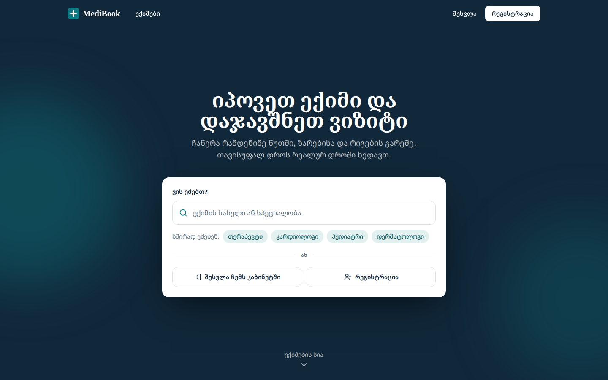
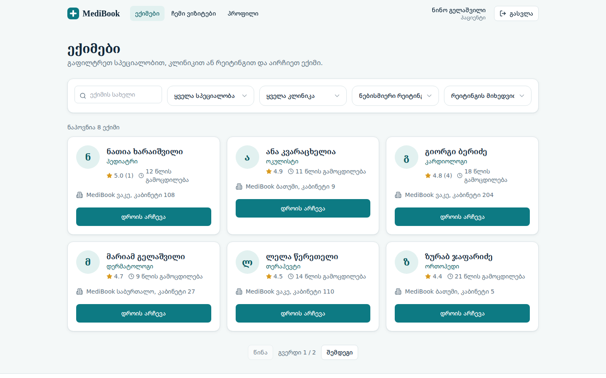
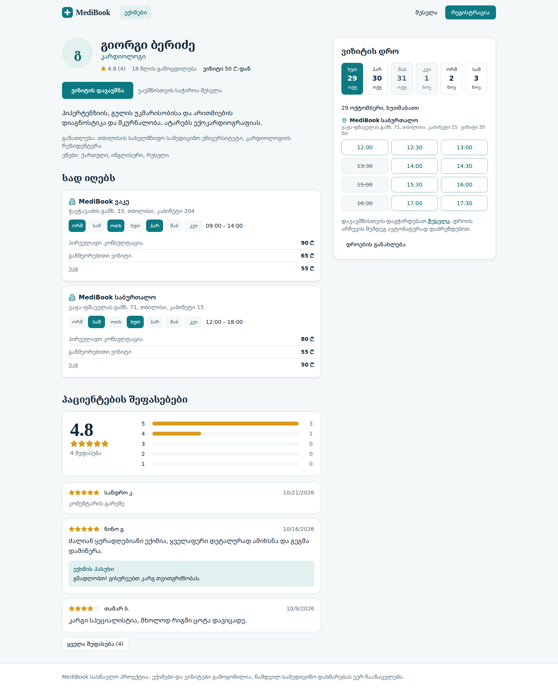
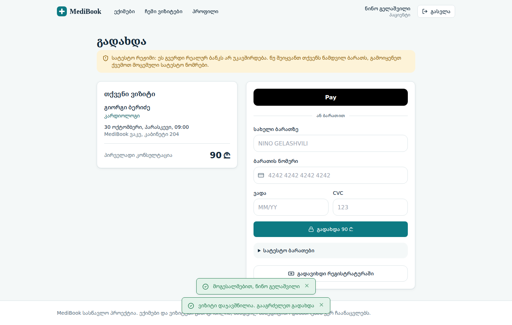
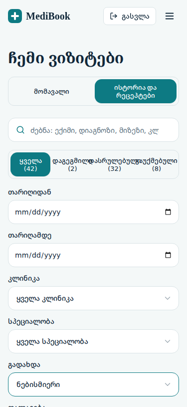
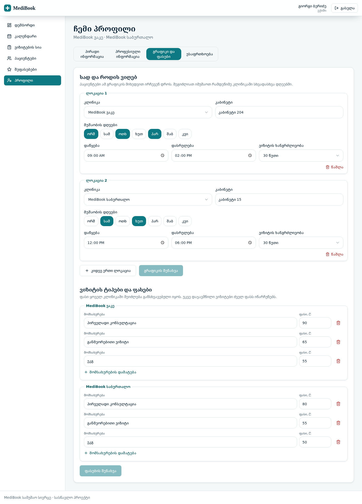
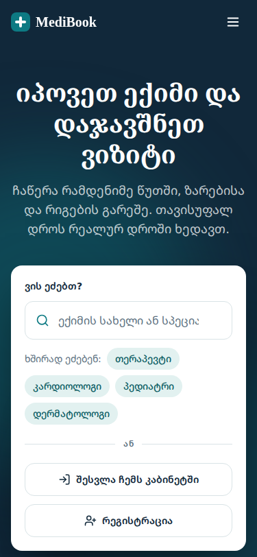
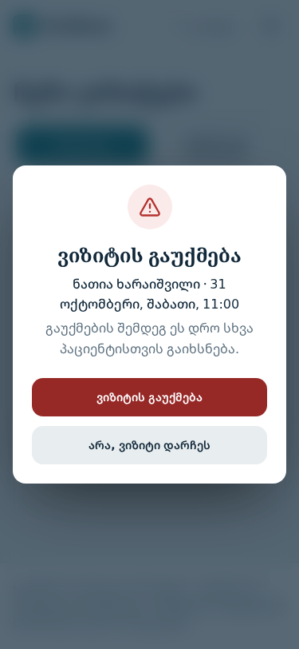
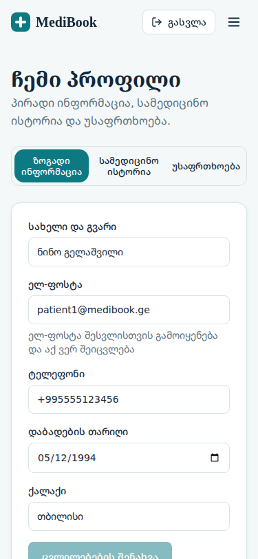
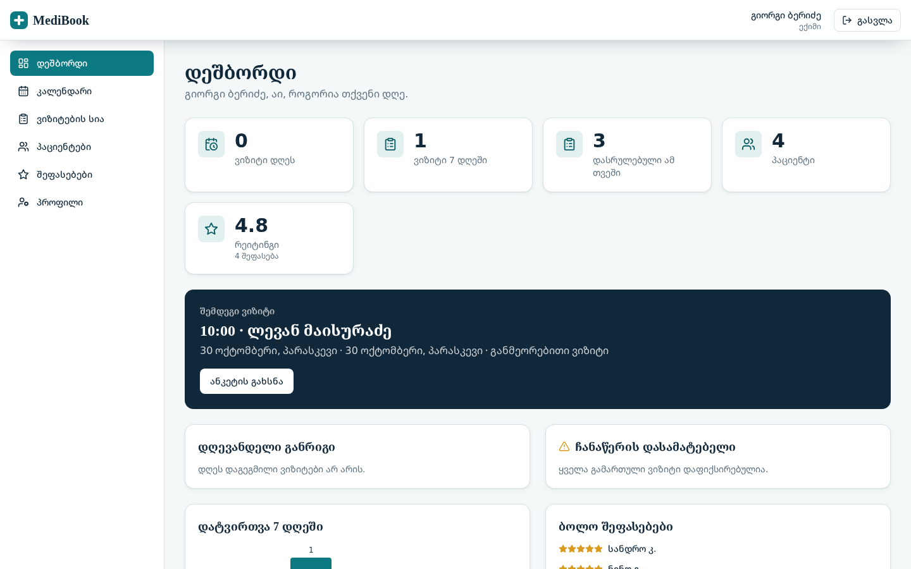

# MediBook

**კლინიკების ონლაინ ჯავშნის სისტემა**: პაციენტი პოულობს ექიმს და ჯავშნის ვიზიტს რამდენიმე წუთში, ექიმი მართავს განრიგს და ჩანაწერებს, ადმინისტრატორი კი გრაფიკებს, კაბინეტებსა და გაუქმებებს.

- **Live Demo:** https://medibook-chi-tan.vercel.app
- **რეპოზიტორია:** https://github.com/tinatinmaisurradze/medibook
- **პროექტის მართვა და დოკუმენტაცია:** Notion-ის ტექნიკური დავალება, UX დოკუმენტი, QA ანგარიში და GitHub Projects დაფა (ბმულები საბოლოო ანგარიშშია)



## პრობლემა და გადაწყვეტა

ექიმთან ვიზიტის დაჯავშნა ხშირად ტელეფონით ხდება: პაციენტი ვერ ხედავს თავისუფალ დროს, ადმინისტრაციას ერთიანი სურათი არ აქვს, ორმაგი ჯავშნის რისკი არსებობს. MediBook ერთ ვებ-აპლიკაციაში აერთიანებს სამ როლს და **ზღუდავს თითოეულს მხოლოდ თავისი სივრცით (RBAC)**.

## ფუნქციები როლების მიხედვით

| როლი | რა შეუძლია |
| --- | --- |
| **პაციენტი** | ექიმის ძებნა (სახელით, სპეციალობით, კლინიკით, ფასით, თავისუფალი დროით), დაჯავშნა კლინიკისა და ვიზიტის ტიპის არჩევით, **ონლაინ (სატესტო) გადახდა ან გადახდა რეგისტრატურაში**, ვიზიტის გაუქმება დადასტურების ფანჯრით, **ვიზიტების ისტორია ფილტრებითა და გვერდებად დაყოფით**, ვიზიტის სრული ანკეტა, ექიმის შეფასება, პროფილი და სამედიცინო ისტორია (გაზიარების კონტროლით) |
| **ექიმი** | დეშბორდი, თვიური კალენდარი, ვიზიტების ძებნა და ფილტრები, პაციენტების ძებნა, დიაგნოზისა და დანიშნულების ჩაწერა, შეფასებები, **საკუთარი გრაფიკი რამდენიმე კლინიკაში (დღეები, საათები, კაბინეტი) და ფასები** |
| **ადმინისტრატორი** | სტატისტიკა და გადახდების მიმოხილვა, ექიმების გრაფიკისა და ფასების რედაქტირება, ყველა კლინიკის ვიზიტები ფილტრებით, ვიზიტების გაუქმება (სამედიცინო ჩანაწერებზე წვდომის გარეშე) |

## ტექნოლოგიური სტეკი

| ფენა | ინსტრუმენტი | რატომ |
| --- | --- | --- |
| UI და ბილდი | React 18, Vite, TypeScript | კომპონენტური არქიტექტურა, სწრაფი ბილდი, ტიპიზაცია |
| სტილები | Tailwind CSS და CSS ცვლადები (Design Tokens) | ერთიანი დიზაინ-სისტემა, რესპონსივობა |
| Routing | React Router | გვერდები, დაცული მარშრუტები (RBAC) |
| ფორმები და ვალიდაცია | React Hook Form და Zod | ერთი სქემა ფორმაშიც და სერვერის მხარესაც |
| State | Context API, custom hooks | გლობალური მდგომარეობა მცირეა (მომხმარებელი, შეტყობინებები) |
| მონაცემები | Mock API ბრაუზერში (localStorage) | იგივე ენდფოინთები, რაც დოკუმენტაციაშია; ერთი ფაილით (`http.ts`) იცვლება რეალურით |
| ხატულები | Lucide (SVG) | მსუბუქი, მასშტაბირებადი |
| ინსტრუმენტები | VS Code, Git/GitHub, Vercel, Chrome DevTools | |

## საქაღალდეების სტრუქტურა

```
src/
├── components/   გლობალური კომპონენტები (ui/: Button, FormField, SelectField, Tabs, ConfirmDialog, States...)
├── context/      AuthContext, ToastContext
├── data/         seed მონაცემები და დემო ანგარიშები
├── hooks/        useAsync, useDebounce, useScrolled, useOnlineStatus
├── layouts/      PublicLayout, DashboardLayout
├── pages/        გვერდები (doctor/ და admin/ ქვეფოლდერებით)
├── services/     http.ts, mockApi.ts და სერვისები
├── types/        TypeScript ინტერფეისები
└── utils/        date, roles, validation (Zod სქემები)
```

## გაშვება ლოკალურად

```bash
git clone https://github.com/tinatinmaisurradze/medibook.git
cd medibook
npm install
npm run dev        # http://localhost:5173
```

სხვა ბრძანებები: `npm run build` (production build), `npm run preview`, `npm run typecheck`.

## სატესტო ანგარიშები

პაროლი ყველასთვის: `Demo1234!`. შესვლის გვერდიდან ანგარიშზე ერთი დაწკაპუნებით შეიძლება შესვლა.

| როლი | ელ-ფოსტა |
| --- | --- |
| პაციენტები | `patient1@medibook.ge`, `patient2@medibook.ge`, `patient3@medibook.ge` |
| ექიმები | `doctor1@medibook.ge` (კარდიოლოგი), `doctor2@medibook.ge` (პედიატრი), `doctor3@medibook.ge` (ნევროლოგი) |
| ადმინისტრატორი | `admin@medibook.ge` |

**ორი პაციენტის დემონსტრაცია:** გახსენით საიტი ორ ბრაუზერის ჩანართში, თითოეულში სხვა პაციენტით. ერთი პაციენტის მიერ დაჯავშნილი დრო მეორე ჩანართში თავისით გადადის „დაკავებულია“-ზე, გადატვირთვის გარეშე. მონაცემების საწყის მდგომარეობაზე დასაბრუნებლად ბრაუზერის კონსოლში: `localStorage.clear()`.

## უსაფრთხოება, ხელმისაწვდომობა და მდგრადობა

- **HTTP უსაფრთხოება:** `vercel.json`-ში გაწერილია Content-Security-Policy, X-Frame-Options, X-Content-Type-Options, Referrer-Policy, HSTS და Permissions-Policy.
- **ვალიდაცია:** ყველა მონაცემი მოწმდება ფორმაშიც და mock სერვერის მხარესაც (Zod), მათ შორის აკრძალული სიმბოლოები და სიგრძე.
- **წვდომა:** ყოველი მოთხოვნა ამოწმებს როლს და იმას, რომ ჩანაწერი ამ მომხმარებელს ეკუთვნის; ადმინისტრატორს სამედიცინო ჩანაწერები არ ჩანს; ბლოკირება 5 წარუმატებელი შესვლის შემდეგ.
- **Accessibility:** სემანტიკური HTML5 (`header`, `nav`, `main`, `section`, `article`, `aside`, `footer`), `aria-label`/`aria-live`, ველებზე მიბმული ლეიბლები, კლავიატურით მართვა (Tab, Enter, Escape, ისრები ძებნაში), ხილული ფოკუსი.
- **მდგრადობა:** `ErrorBoundary` (თეთრი ეკრანის წინააღმდეგ), ღილაკების დაბლოკვა გაგზავნისას (ორმაგი დაჭერის დაცვა), Offline რეჟიმის შეტყობინება, Loading/Empty/Error მდგომარეობები.
- **წარმადობა:** `React.lazy` + `Suspense` გვერდებზე, `useDebounce` ძებნაზე, `useMemo`/`useCallback`/`React.memo`, SVG ხატულები.

## რეალური სერვერი (არასავალდებულო)

საიტი ნაგულისხმევად mock API-ზე მუშაობს ბრაუზერში. რეალური სერვერის გასაშვებად:

```bash
npm run server                      # http://localhost:4000, მონაცემები: server/data/db.json
```

შემდეგ `.env.local` ფაილში ჩაწერეთ `VITE_API_URL=http://localhost:4000` და გაუშვით `npm run dev`. სერვერი იგივე API ლოგიკას იყენებს, მაგრამ დამატებით: პაროლები ჰეშირებულია (scrypt), ტოკენები ხელმოწერილი HS256 JWT-ია, CORS მხოლოდ დაშვებული მისამართებისთვის, მოთხოვნის ზომისა და სიხშირის ლიმიტი, მონაცემები ინახება სერვერზე და ყველა მოწყობილობას საერთო აქვს. პარამეტრები: `.env.example` (პროდაქშენში აუცილებელია `JWT_SECRET`).

## ლოკაციები და გეოგრაფია

დემო მონაცემებში 20 კლინიკაა: **13 თბილისში** (მუნიციპალიტეტების/უბნების მიხედვით) და **7 ბათუმში**, ოთხი ქსელის ფილიალებით. ქსელების სახელები რეალისტური მაგალითია, მისამართები პირობითია. ექიმების ძებნა ფილტრდება **რეგიონით, მუნიციპალიტეტით და კლინიკით**. წესი: **ექიმი მუშაობს ერთ ქალაქში**. ერთი ქალაქის რამდენიმე კლინიკა ან სხვადასხვა ქსელის ფილიალი დასაშვებია, ორ ქალაქში (მაგ. ორშაბათს თბილისში და ოთხშაბათს ბათუმში) გრაფიკი შეუძლებელია; ამას სერვერიც ამოწმებს და გრაფიკის რედაქტორიც.

## გადახდა

გადახდის გვერდი **სატესტო (demo) რეჟიმშია**: რეალურ ბანკს არ უკავშირდება. ბარათი მოწმდება (Luhn, ვადა, CVC), შენახვა მხოლოდ ბრენდს და ბოლო 4 ციფრს ეხება. სატესტო ბარათები: `4242 4242 4242 4242` (წარმატება), `4000 0000 0000 0002` (უარყოფა), `4000 0000 0000 9995` (თანხა არასაკმარისია).

## ტესტირება

გადამოწმდა 375px, 768px და 1440px სიგანეზე. ავტომატურად შემოწმდა სერვერის წესები (მათ შორის ორმაგი ჯავშნის აღკვეთა, როლებზე წვდომა, ვალიდაცია) და ინტერფეისის ძირითადი სცენარები. ხელით ტესტირების სცენარები და ნაპოვნი ბაგები QA ანგარიშშია.

## ეკრანები

| ძებნა (1440px) | ექიმის გვერდი: რამდენიმე კლინიკა (1440px) |
| --- | --- |
|  |  |

| სატესტო გადახდა (1440px) | ვიზიტების ისტორია ფილტრებით (375px) |
| --- | --- |
|  |  |



| ლენდინგი (375px) | გაუქმების დადასტურება (375px) | პროფილი (375px) |
| --- | --- | --- |
|  |  |  |



## Roadmap (Version 2.0)

1. **რეალური გადახდის პროვაიდერი** (ბანკის ან გადახდის სერვისის ინტეგრაცია) სატესტო გვერდის ნაცვლად.
2. **ბაზა და გამოქვეყნებული სერვერი** (PostgreSQL, ჰოსტინგი) და კლინიკის ადმინისტრატორის როლი, რომელიც მხოლოდ საკუთარ კლინიკას ხედავს (სააბონენტო მოდელი).
3. **შეხსენებები ელფოსტით/SMS-ით**, ავტომატური end-to-end ტესტები და ძებნის გაუმჯობესება ათასობით ექიმზე.

## ავტორი

ინდივიდუალური პროექტი. AI-ასისტენტი გამოყენებულია როგორც ინსტრუმენტი კოდისა და დოკუმენტაციის მოსამზადებლად; პროექტის არჩევანი, ფუნქციები, გადამოწმება და საბოლოო გადაწყვეტილებები ავტორისაა.
